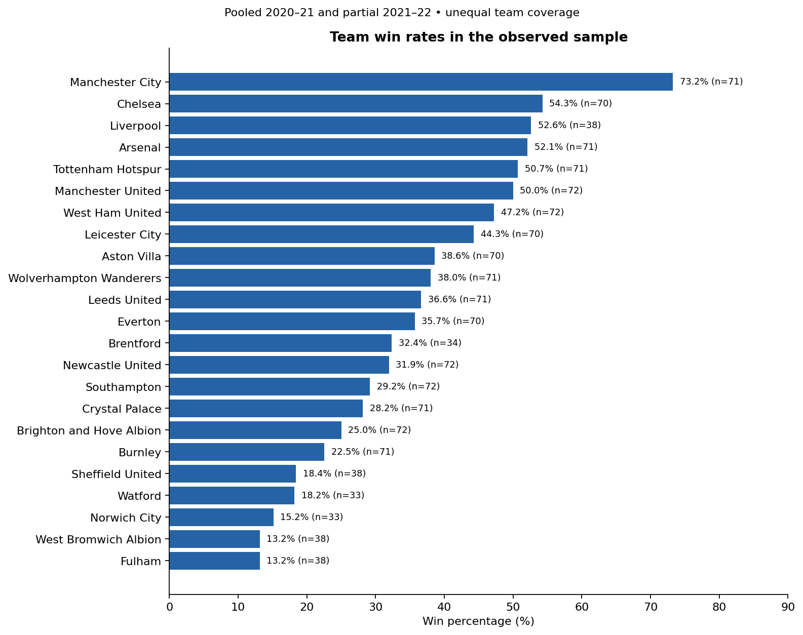
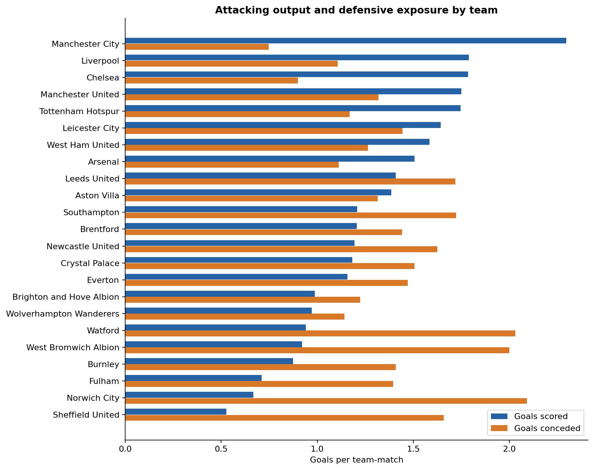
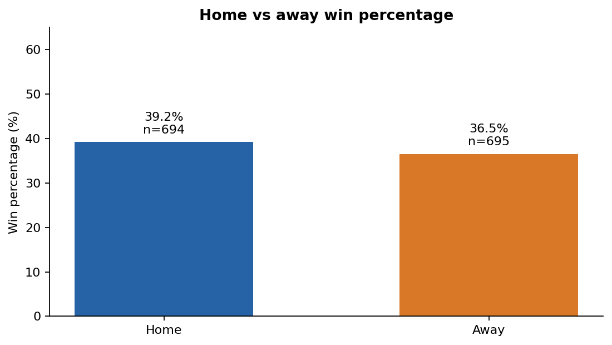
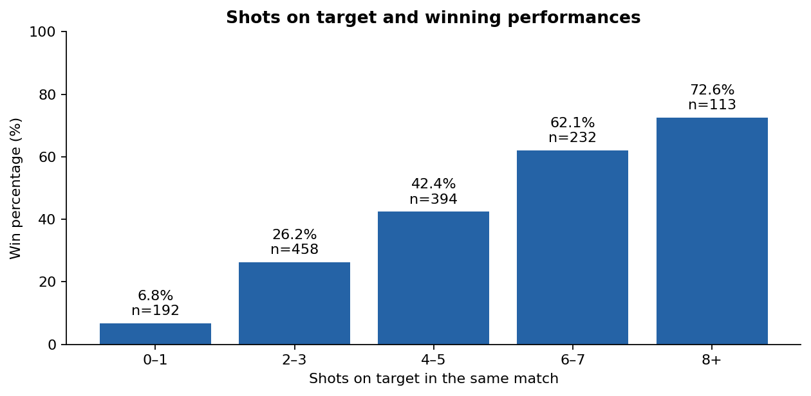
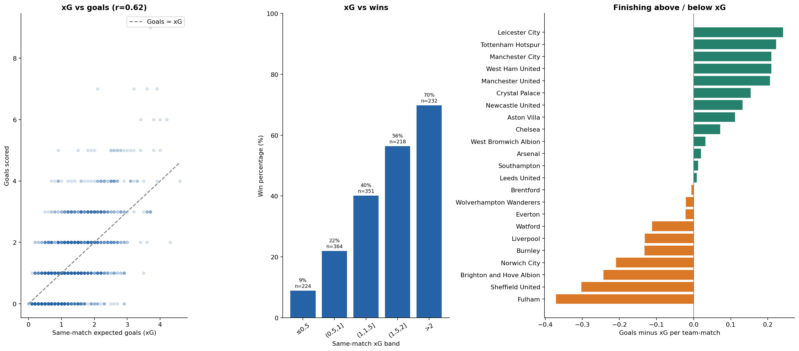

# Premier League performance analysis and win prediction

An end-to-end Python project that turns historical football match statistics into clear performance insights, then tests whether recent team form helps predict a win. It combines data-quality checks, exploratory analysis, five visualizations and a chronological Random Forest evaluation.

**The prediction is binary: `1 = win`, `0 = non-win (draw or loss)`.** It does not predict draws and losses separately.

**Start with the [executed analysis notebook](PremierLeagueAnalysis.ipynb)** to see the questions, code, tables, charts and model results together.

## Try the matchup webpage

Open [web/index.html](web/index.html) in a browser after downloading the repository. **Matchday** lets you select a home and away team, swap venues, see the model's pick or an uncertain result, and inspect the last three recorded matches behind it. It runs entirely in your browser, with no account, server or API key required. GitHub displays HTML source rather than running it; download the folder before opening the page.

The page uses the same pre-2022 training split and Random Forest settings as the evaluated rolling model. It contains 506 precomputed ordered matchups across all 23 recorded teams, assuming a Saturday 15:00 kickoff. Each hypothetical next fixture uses the team's latest three completed matches. The two win scores are independent binary estimates: they are not normalized to total 100%, are not calibrated probabilities, and do not supply a draw probability. A winner is shown only when one team exceeds 50% and the other does not; otherwise the result is “No clear winner.” The hypothetical matchup tool itself has not been separately validated.

Explanations include actual model sensitivity checks: replace attacking/defensive inputs with training-period medians or toggle venue, holding other inputs fixed. These changes explain model behavior, not causation or additive feature attribution. The page shows source dates and flags older snapshots, including Liverpool's 2021 records. **This is a historical demo, not current-season forecasting.**

Regenerate the website data and a portable single-file edition with:

```bash
python build_web.py
```

Then open `web/matchday.html`. This generated file includes all styles and data and can be shared as a single file. To publish the webpage, the contents of `web/` can be served by any static host. No public hosting is configured by this change.

Validation commands:

```bash
python -m unittest discover -s tests -p test_web_model.py
node --test tests/test_web.cjs
```

## Key findings

- **Win rates:** Manchester City leads the observed sample at 73.2% (52 wins in 71 team-matches). These are pooled sample rates, not a complete 2021–22 league table.
- **Home advantage:** home teams win 39.2% of their records versus 36.5% away, a 2.6 percentage-point gap. This describes association; it does not isolate a causal venue effect.
- **Shots on target:** win rates rise from 6.8% for 0–1 shots on target to 72.6% for 8+. These same-match statistics describe performance after the match.
- **Expected goals:** same-match xG and goals have a Pearson correlation of 0.62. Teams win 8.9% of records with xG ≤0.5 and 69.8% with xG >2.
- **Attack and defense:** Manchester City averages 2.30 goals scored and 0.75 conceded per match. The notebook compares both measures for every team.
- **Finishing versus xG:** Leicester City has the largest positive goals-minus-xG gap (+0.24 per match); Fulham has the largest negative gap (-0.37). This is not expected points or evidence that the gap will persist.

## Dataset and its limits

The checked-in [matches.csv](matches.csv) contains **1,389 team-match rows across 23 teams**, dated 12 September 2020 through 25 April 2022. A row is one team's perspective on a fixture: most fixtures appear from both teams' perspectives, so 1,389 is not the number of distinct fixtures.

| Season | Team-match rows | Teams | Coverage |
| --- | ---: | ---: | --- |
| 2020–21 (`season=2021`) | 760 | 20 | 38 records per team |
| 2021–22 (`season=2022`) | 629 | 19 | Partial, through 25 April; Liverpool team records absent |

Teams have unequal sample sizes and some appear in only one season. Charts use percentages or per-match averages, show counts where relevant, and the notebook includes season-level comparisons. Pooled rankings still reflect different schedules and season coverage.

There are no duplicate team/date rows. Attendance is missing in 696 rows, notes in every row, and shot distance in one row. All fields used for EDA are complete. Missing rolling inputs are not imputed. The existing CSV is unchanged. The earlier README described public web scraping but provided no source URL or scrape date; provenance and the xG provider cannot be verified from this repository.

## Explore the evidence

### Which teams win most often?


### How do scoring and conceding compare?


### How different are home and away results?


### How are shots on target associated with wins?


### How does xG relate to goals, wins and finishing performance?


Same-match goals, shots on target and xG explain observed performance. They are not known at kick-off, so they are not directly used as pre-match model features. Correlations do not establish causation; the two perspectives on a fixture are also related observations.

## Model and measured results

The existing `RandomForestClassifier(n_estimators=50, min_samples_split=10, random_state=1)` is retained. The baseline uses venue, opponent category code, match hour and weekday. The form model adds three-match rolling averages of goals scored (`gf`), goals conceded (`ga`), shots (`sh`), shots on target (`sot`), shot distance (`dist`), free kicks (`fk`), penalties scored (`pk`) and penalties attempted (`pkatt`). There is no parameter tuning or new model family.

| Model | Training rows | Test rows | Accuracy | Win precision | Win recall | Predicted wins |
| --- | ---: | ---: | ---: | ---: | ---: | ---: |
| Baseline | 1,107 | 282 | 61.35% | 48.33% | 27.10% | 60 |
| With rolling features | 1,035 | 282 | 66.31% | 62.50% | 28.04% | 48 |
| Baseline on rolling-eligible rows | 1,035 | 282 | 60.28% | 45.28% | 22.43% | 53 |

The baseline achieves **61.35% accuracy and 48.33% win precision**; adding rolling features yields **66.31% accuracy and 62.50% win precision**. The same-row baseline control separates feature changes from the training rows lost when building rolling windows. All three evaluations use the same test records in this dataset.

Accuracy counts all correct classifications. Precision asks “of the wins predicted, how many were wins?” Recall asks “of all actual wins, how many were found?” Always predicting non-win achieves **62.06% accuracy** but finds no wins (precision is reported as zero by convention). Consider all three metrics rather than treating accuracy alone as success.

The baseline's accuracy is below that simple benchmark. Rolling features improve accuracy by 4.96 percentage points and precision by 14.17 points, but the model still detects only 28.04% of actual wins. This is a modest historical improvement, not a reliable all-purpose match predictor.

Exact scores are in [model_results.csv](analysis/model_results.csv), with per-row [baseline](analysis/baseline_predictions.csv) and [rolling](analysis/rolling_predictions.csv) predictions. Confusion matrices are displayed in the notebook. Results are measured on this historical holdout, not a claim about future betting performance.

### Chronological split

Training includes dates **before 1 January 2022**. Testing includes dates **on or after 1 January 2022**, through the last available record. There is no random shuffle of train/test membership, and both team perspectives of a fixture remain on the same side of the date boundary.

The original experiment used `date > '2022-01-01'` for testing, leaving the cutoff day out of both sets. The new analysis uses `>=` to close that gap. Historical cached outputs in the original notebook therefore need not match these rerun results. Package versions can also affect reproducibility.

### Why `closed='left'` matters

```python
group = group.sort_values('date')
rolling_stats = group[cols].rolling(3, closed='left').mean()
```

For match **t**, the window contains **t−3, t−2 and t−1**, excluding the current match. This prevents current-match goals or shots from leaking into its prediction. Three complete previous observations are required; the first three matches for each team and windows affected by missing distance are dropped (72 rows in total). Windows follow available matches and span seasons, matching the original logic.

This is a **sequential pre-match evaluation**: the model is fitted once on the training period, while later test fixtures can use statistics from earlier completed test fixtures. It is not a forecast of every remaining fixture using only information available on 1 January. The notebook checks every retained window against a one-match shift followed by a three-match average.

## Reproduce the analysis

Use Python 3.12 from the repository root:

```bash
python -m venv .venv
# Activate: Windows PowerShell: .venv\Scripts\Activate.ps1
# Activate: macOS/Linux: source .venv/bin/activate
python -m pip install -r requirements.txt
python analysis.py
python build_notebook.py
```

`analysis.py` regenerates the figures, summary tables, predictions and metrics. `build_notebook.py` builds and executes the notebook from the same script, retaining table/metric outputs and linking the five committed chart files to avoid duplicating image data. A notebook viewer such as VS Code can also open the committed notebook without rerunning it. The run's package versions and dataset SHA-256 are recorded in [run_metadata.json](analysis/run_metadata.json).

| File | Purpose |
| --- | --- |
| [PremierLeagueAnalysis.ipynb](PremierLeagueAnalysis.ipynb) | Main executed analytics narrative |
| [analysis.py](analysis.py) | Reproducible EDA and model evaluation; notebook cell source |
| [build_notebook.py](build_notebook.py) | Build and execute the analysis notebook |
| [analysis/](analysis/) | Five charts, summary tables, metrics and predictions |
| [PremierLeague.ipynb](PremierLeague.ipynb), [PremierLeague_export.py](PremierLeague_export.py) | Original modeling walkthrough, retained for comparison |
| [matches.csv](matches.csv) | Unchanged input data |

## Limitations and next steps

The project demonstrates data auditing, grouped analysis, visualization, feature engineering, honest holdout evaluation and an interactive historical matchup demo. The webpage stores precomputed model outputs, not a live prediction service or exported model object. The main limitations are incomplete coverage, undocumented provenance, one historical test period, arbitrary numeric opponent codes and related team-match observations. Category labels are constructed from the full CSV as in the original project; future work should fit encodings on training data and handle unseen opponents explicitly.

Priorities for a separate modeling iteration are to restore complete fixture coverage, document the data source, evaluate several chronological windows, inspect probability calibration and test stronger baselines. The current work preserves the original modeling approach rather than claiming those improvements have already been made.
